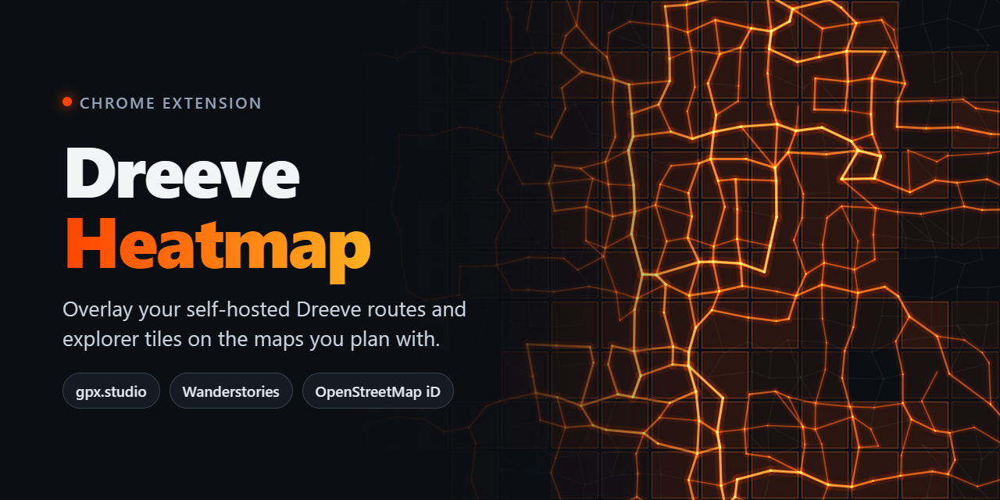

<p align="center">
    
</p>

<p align="center">
    <a href="https://github.com/Luen/dreeve-heatmap-plugin/releases"></a>
    
    <a href="https://github.com/dreeveapp/dreeve"></a>
</p>

# Dreeve Heatmap Plugin

A Chrome extension that draws your **self-hosted [Dreeve](https://github.com/dreeveapp/dreeve) heatmap** — every route you've recorded, plus your explorer tiles — directly on top of the route-planning and mapping tools you already use.

Plan your next ride on gpx.studio and instantly see which roads you've already covered. Spot unexplored tiles. Check your own tracks while mapping in the OpenStreetMap iD editor.

<p align="center">
    
</p>

## Contents

- [Features](#features)
- [Supported sites](#supported-sites)
- [Requirements](#requirements)
- [Install](#install)
- [Usage](#usage)
- [How it works](#how-it-works)
- [Troubleshooting](#troubleshooting)
- [Development](#development)

## Features

- 🔥 **Route heatmap** — draws all your Dreeve activity polylines on the page's map
- 🟧 **Explorer tiles** — visited, cluster, max-cluster and max-square tiles, matching the Dreeve heatmap
- 🎛️ **Independent layers** — toggle **Show routes** and **Show tiles** separately (both on by default)
- 🚴 **Sport filters** — `Ride`, `Walk`, `Water`, `Winter`; applies to routes and tiles. Virtual activities (`VirtualRide`, `VirtualRun`) are always excluded
- 🎨 **Styling** — shared colour and opacity for routes and tiles, plus route line width
- 🔎 **Activity popups** — click a route to see activity details and links back to Dreeve
- ⚡ **Fast** — cached payloads with `ETag` revalidation, Web Worker route parsing, and style changes that don't re-fetch geometry
- 🏠 **Your data, your server** — points at any Dreeve endpoint you choose; nothing goes through a third party

## Supported sites

| Site                                                          | Map engine     | Routes | Explorer tiles |
| ------------------------------------------------------------- | -------------- | :----: | :------------: |
| [gpx.studio](https://gpx.studio)                              | MapLibre GL JS |   ✅   |       ✅       |
| [Wanderstories Studio](https://studio.wanderstories.space)    | Mapbox GL JS   |   ✅   |       ✅       |
| [OpenStreetMap iD editor](https://www.openstreetmap.org/edit) | iD (SVG)       |   ✅   |       —        |

## Requirements

| Feature        | Minimum Dreeve                                                    | Endpoint                       |
| -------------- | ----------------------------------------------------------------- | ------------------------------ |
| Routes         | [v5.3.0](https://github.com/dreeveapp/dreeve/releases/tag/v5.3.0) | `/api/internal/heatmap/routes` |
| Explorer tiles | [v5.6.0](https://github.com/dreeveapp/dreeve/releases/tag/v5.6.0) | `/api/internal/heatmap/tiles`  |

You only configure the **routes** URL; the tiles URL is derived from it automatically.

> [!NOTE]
> Older Dreeve endpoints (`/api/heatmap/routes.json` and `/api/fragment/data/heatmap/routes`) are no longer supported.

## Install

The extension is not on the Chrome Web Store yet. Install it unpacked:

1. Download or clone this repository:
    ```bash
    git clone https://github.com/Luen/dreeve-heatmap-plugin.git
    ```
2. Open `chrome://extensions` and enable **Developer mode** (top right).
3. Click **Load unpacked** and select the repository folder.
4. Pin the extension so the popup is one click away.

Works in Chrome and other Chromium-based browsers (Edge, Brave, Arc, …).

## Usage

### gpx.studio and Wanderstories

1. Open [gpx.studio](https://gpx.studio) or [Wanderstories Studio](https://studio.wanderstories.space).
2. Open the extension popup and enter your Dreeve routes endpoint, for example:
    ```text
    http://localhost:8000/api/internal/heatmap/routes
    ```
3. Choose **Show routes** / **Show tiles**, colour, opacity, width and sport filters.
4. Click **Enable**. While enabled, popup changes apply immediately.
5. Click **Disable** to remove the overlay.

### OpenStreetMap iD editor

1. Open the [iD editor](https://www.openstreetmap.org/edit), e.g. `https://www.openstreetmap.org/edit#map=16/48.82523/-125.13630`.
2. Open the extension popup, set your endpoint and click **Enable**.
   (**Show tiles** is disabled here — iD supports routes only. Your tile preference for other sites is kept.)
3. Press <kbd>B</kbd> for **Background settings** and scroll to **Overlays**.
4. Toggle **Dreeve Routes** on or off.
5. Click **Disable** in the popup to unload the data and remove the overlay entry.

### Style examples

| Setting      | Example                                        |
| ------------ | ---------------------------------------------- |
| Colour       | `#ff4500` (default), `#00bcd4`                 |
| Opacity      | `0.2`                                          |
| Width        | `3`                                            |
| Sport filter | `Ride` (includes road, gravel, MTB and e-bike) |

Settings save automatically to `chrome.storage.sync` and follow you across browsers where you're signed in.

## How it works

```text
 Popup / options ──► chrome.storage.sync
        │
        ▼
 Background service worker ──fetch──► Your Dreeve server
   (cache + ETag)                     /api/internal/heatmap/routes
        │                             /api/internal/heatmap/tiles
        ▼
 Content script ──► Web Worker (normalize routes)
        │
        ▼
 Page bridge ──► MapLibre / Mapbox GL layers, or iD SVG overlay
```

- **Fetching** happens in the background service worker, so page-level CORS rules don't get in the way.
- **Caching:** route and tile payloads are kept in memory and `chrome.storage.session` for about 20 minutes, revalidated with `ETag` / `If-None-Match` when your server supports it. A fresh **Enable** after **Disable** always refetches.
- **Rendering:** style-only changes (colour, opacity, width) update the map without re-fetching or re-parsing geometry.
- **OpenStreetMap:** `/edit` embeds iD in an `/id` iframe; the extension hooks that iframe at boot and messages it from the popup.

### Endpoint format

The routes endpoint returns an array of activities with `coordinates` as `[lat, lng]` pairs:

```json
[
    {
        "id": "activity-123",
        "coordinates": [
            [-19.37, 146.64],
            [-19.38, 146.65]
        ]
    }
]
```

### Permissions

| Permission                           | Why                                                           |
| ------------------------------------ | ------------------------------------------------------------- |
| `storage`                            | Save your endpoint, layer toggles, style and filters          |
| `tabs`, `scripting`, `webNavigation` | Inject the overlay into supported map sites and the iD iframe |
| `http://*/*`, `https://*/*`          | Reach your self-hosted Dreeve server, wherever it lives       |

## Troubleshooting

| Symptom                               | Fix                                                                                     |
| ------------------------------------- | --------------------------------------------------------------------------------------- |
| Overlay doesn't appear                | Click **Reload** on the extension in `chrome://extensions`, then refresh the map tab.   |
| Nothing on the iD editor              | Reload `/edit` after installing or updating so the editor boot hook can run.            |
| Popup shows a fetch error             | Check the endpoint is reachable from your browser's network (VPN, LAN, firewall).       |
| Endpoint returns HTML instead of JSON | Make sure you're on Dreeve **v5.3.0+** and using `/api/internal/heatmap/routes`.        |
| Routes work but tiles fail            | Tiles need Dreeve **v5.6.0+** with `/api/internal/heatmap/tiles` reachable.             |
| Self-signed HTTPS certificate         | Open the endpoint in a normal tab first and accept the certificate so Chrome trusts it. |

## Development

Requires **Node.js 20+**. Tooling is for formatting and linting only — there is no build step, so the repository folder is the unpacked extension.

```bash
npm install
npm run format    # Prettier (write)
npm run lint      # ESLint
npm run check     # format check + lint
```

Branches: open feature and fix PRs against **`dev`**; **`main`** is production. See [AGENTS.md](AGENTS.md) for conventions and the release process.

The social preview image is generated from [`.github/assets/social-preview.html`](.github/assets/social-preview.html) — instructions are in the file header.

## Related

- [Dreeve](https://github.com/dreeveapp/dreeve) — self-hosted activity statistics and heatmaps
- [gpx.studio](https://gpx.studio) — online GPX route planner and editor
- [OpenStreetMap iD](https://github.com/openstreetmap/iD) — the web editor for OpenStreetMap
